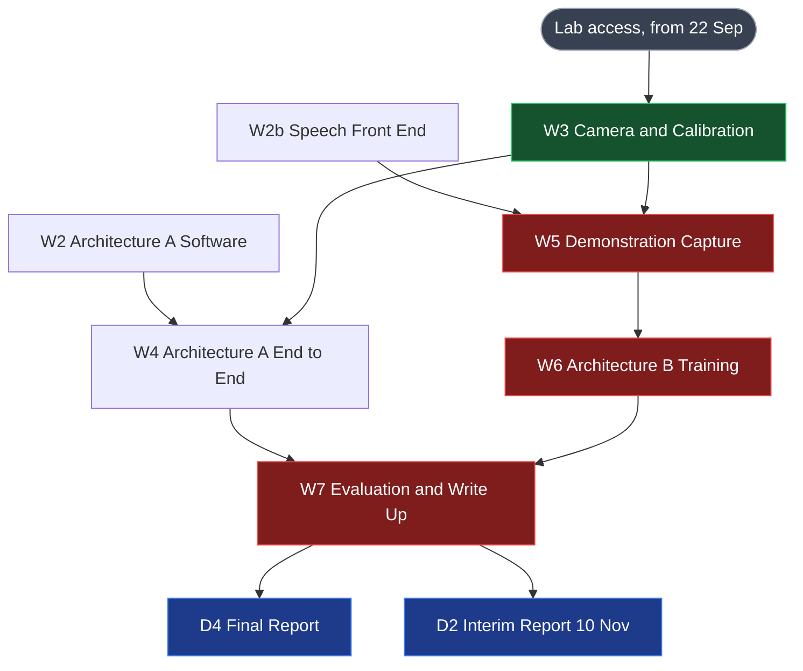
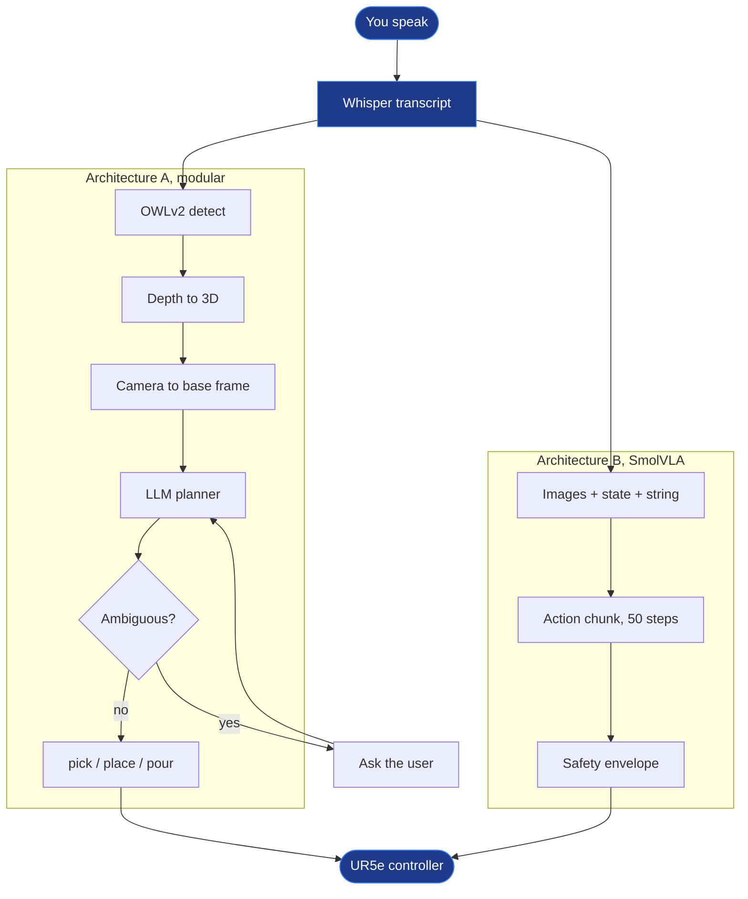
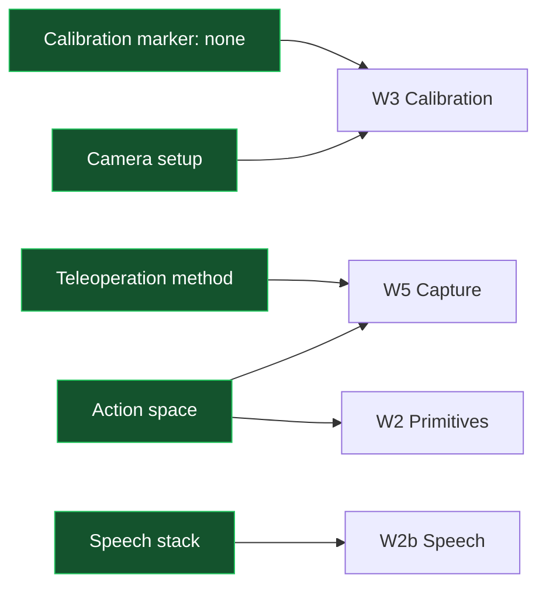

# Flowchart

Switch to reading view (Ctrl+E) to see these render. Mermaid is built into Obsidian, so nothing needs installing.

The graph view cannot show this. It is force directed and undirected, so it shows *that* two notes are linked but never which way the dependency runs. That is what these are for.

## Critical path

Everything that has to happen in order, and what can be done in parallel while waiting for the lab.

Red is the critical path. Green is in progress. Grey is done.

Lab access was the amber blocker until about 22 Sep, when the arm became available after the lab move. The critical path now runs through W3 on the real cell, then demonstration capture, then training.

## Runtime, both architectures

What actually happens when you speak a command. Shared parts are the point: if these diverge, the comparison measures plumbing instead of architectures.

Blue is shared by both. Note that **Architecture B has no path back to the user**: there is no arrow returning from B to the microphone, and that missing arrow is the entire [[Tasks#Tier 2 Ambiguity\|Tier 2 Ambiguity]] result.

## Decisions and what they block

No decision is open. [[Decisions to Make#Action space\|Action Space]] was the last one, settled on 23 Sep when the rotation format was fixed, before any episode was recorded.

[[Decisions to Make#Calibration marker\|Calibration Marker]] closed on 12 Aug with no marker.

## Keeping these current

These are hand written, so they go stale if the plan changes and nobody updates them. Worth one minute after any scope change. The source of truth stays [[Weekly Focus]] and `docs/fyp_plan.md`.

## Other ways to draw things in Obsidian

* **Canvas** is a core plugin and already enabled: right click in the file explorer, New canvas, then drag notes in as live cards and draw arrows between them. Better than Mermaid when you want to rearrange by hand, worse when you want it version controlled and diffable
* **Excalidraw** is a community plugin for sketching, useful for figures in [[FYP Submissions#D4 Final Report\|D4 Final Report]]
* **Juggl** is a community plugin that replaces the graph view with one supporting directed layouts, if you specifically want the *whole vault* laid out rather than a curated diagram
